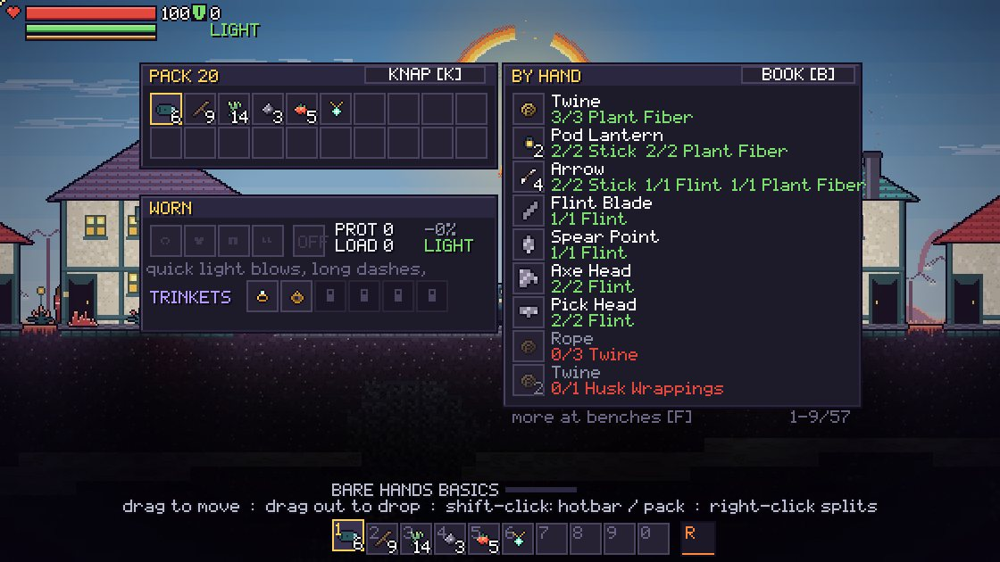

# Controls

| Key | What it does |
| --- | --- |
| **A / D** | move |
| **Space** or **W** | jump (hold **S** to drop through bridges) |
| **Shift** | dodge (dodge through a hit at the last moment, then strike back: a riposte) |
| **Left mouse** | light attack; hold it to keep attacking. Clicking a creature always punches it, whatever you hold |
| **Right mouse** or **Q** | heavy attack (hold to charge); also opens doors |
| **V** | change weapon style (five per weapon, unlocked by training) |
| **X** | swap to your off-hand weapon (pairs make combo finishers) |
| **1** to **0**, mouse wheel | hotbar |
| **E** | your pack, what you wear, and crafting by hand |
| **B** | the recipe book: every bench, what it is for and what it makes |
| **G** | drop one of what you hold (**Shift+G** drops the whole stack) |
| **F** | talk, use a bench, sleep, plant, take honey, wake a guardian with its offering, touch a rift or an echo stone |
| **H** | quick heal |
| **J** | journal: leads, lore, echoes, bestiary |
| **M** | map (once you have drawn one; in the battle royale, the island) |
| **K** | knapping (optional: stone heads can also be made by hand from flint) |
| **C** | forms (your moves) |
| **R / T** | throw / switch sidearm |
| **O** | sound on or off |
| **P** or **Esc** | menu (**PLAY TOGETHER** is in here) |
| **Enter** | chat, when playing with friends |

## Your pack

Press **E**. Drag a stack to move it, drag one out of the pack to drop it, and shift-click to send a stack between the hotbar and the pack. Right-click splits a stack. Chests, crates, barrels and strongboxes have **TAKE ALL** and **STORE ALL** (store all keeps your hotbar as it is).

Under the pack, **WORN** holds your armour, your off-hand weapon and your **trinkets**. Right-click armour or a trinket in your pack to put it on, or drop it on its slot. The **BOOK** button (or **B**) opens the recipe book.

## Your hands

Anything you only carry (ore, bars, rope, keys, sidearms) leaves your fists free. Click and you punch: jab, cross, hook, uppercut. Aim up for an uppercut, aim down or hold **S** for a low kick, and use the right mouse button for a haymaker.

Blocks, food and other usable things still do their job when you click empty space, but a click on a creature is always a punch. Tools swing where you point and hit creatures as well as rock. Pointing at ground within reach with empty hands digs by hand.

## The menu (Esc)

- **Controls: SIMPLE** (the default). Only where you aim (up, straight, down) and holding **S** choose your attack, so you never lunge or dash across the screen by surprise. **FULL** brings back the extra forms tied to the movement keys and how far away the cursor is (the forms page, **C**, greys them out in SIMPLE).
- **Difficulty: EASY** (the default): you take 30% less damage, heal twice as fast and get hungry more slowly. **NORMAL** is the original balance. **HARD**: 25% more damage taken, slower healing, faster hunger.
- **Crafting: SIMPLE** (the default). At a station you click what you want and it is made after a short bar fills (shift-click makes five). Fires and kilns work whenever they have fuel, and light themselves from your sticks or logs; food never burns. **HANDS-ON** brings back the station games (sawing, the potter's wheel, the bellows, the anvil...), heat and the kiln's damper, and food that chars if you forget it.
- **FPS MODE: OFF** (the default). Turn it on to stop ambient effects and particle effects for smoother play on slower computers. It changes only decoration; world simulation, gameplay and multiplayer stay the same.

All four are remembered on this computer.
