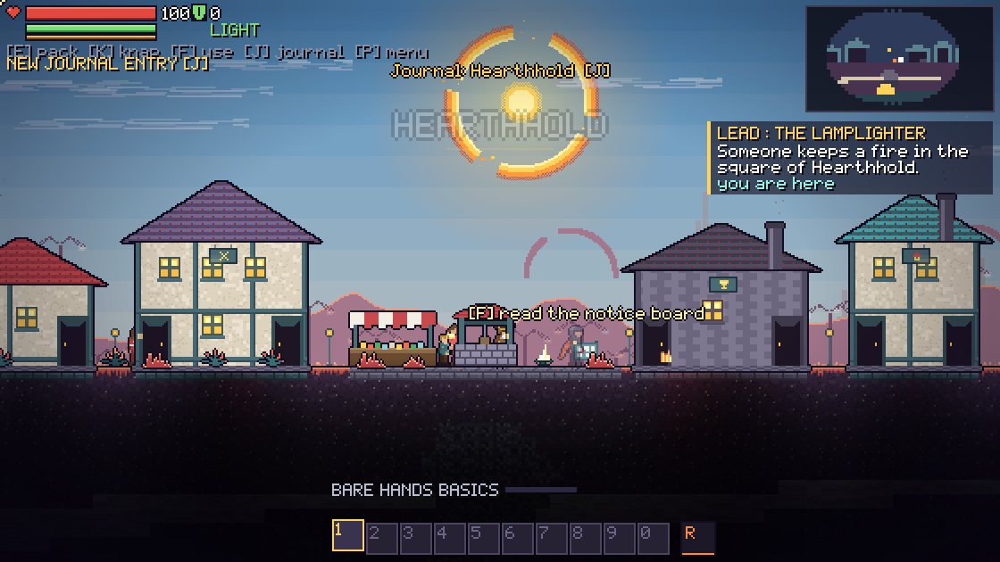
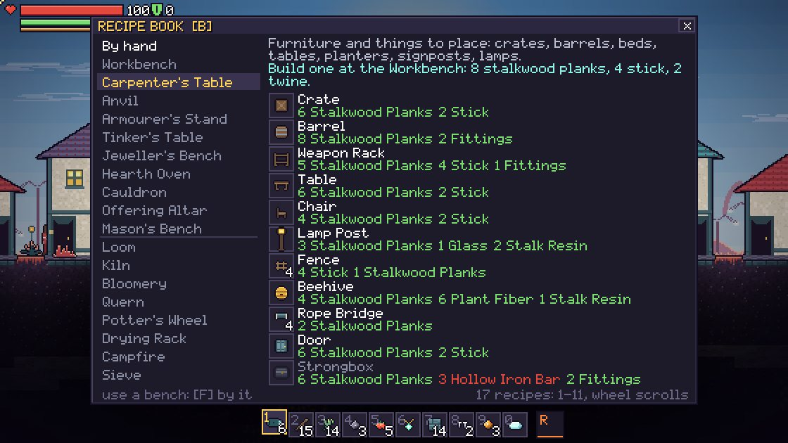
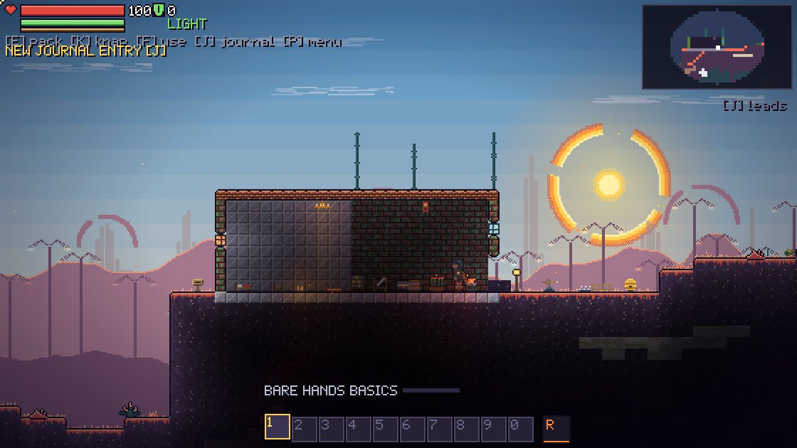

# How to play

You wake with nothing. Everything after that is up to you: there is no wrong order, and nothing forces you along.

## Crafting

Open your pack (**E**). The **BY HAND** list shows everything you can make anywhere. Green lines you can make now, and each ingredient shows what you have against what it needs (for example *2/3 Plant Fiber*). Hover a line to see it spelled out, and click to make it. The things you can almost make come first.

Everything else is made at **benches** you build and place. Each bench has one job, so you always know where to go. Stand next to one and press **F**: its list works the same way, and a bench with a long list has a **SHOW** button (weapons, tools, armour...) and a **CAN MAKE** switch. Every item's tooltip says where it is made, and the **recipe book** (**B**) lists every bench, what it is for, how to build it, and everything it makes.

| Bench | What it is for |
| --- | --- |
| **Workbench** | woodwork: planks, doors, ladders, wooden and bone weapons, and most other benches |
| **Carpenter's Table** | furniture and things to place: crates, barrels, beds, tables, planters, signposts, lamps |
| **Anvil** | metal weapons and tools. Stone anvil: copper and bronze. Iron anvil: iron and steel. Slagforge: the metals of the other worlds |
| **Armourer's Stand** | every piece of armour. Metal armour also needs an anvil of the same rank close by |
| **Tinker's Table** | gadgets you carry (lanterns, glider, climbing claws, compass, gauges), traps and the ember ballista |
| **Jeweller's Bench** | trinkets you wear: rings, charms and amulets |
| **Hearth Oven** | hot meals that give a boon for a few minutes |
| **Cauldron** | brews: salves, tonics, antidotes, flasks to throw |
| **Offering Altar** | the offerings that wake the guardians, the lamps that call the sky, and the keys between worlds |
| **Mason's Bench** | cut stone: blocks, walls, statues, fountains, the stone anvil and the oven |

The **workshops** turn raw things into materials: the kiln (brick, glass, charcoal, pots), the bloomery (ore into bars), the loom (cloth, rugs, banners, bags), the quern (ore, powder, flour), the potter's wheel, the drying rack, the sieve and the campfire.

## Trinkets and meals

**Trinkets** work while you wear them. You start with **two trinket slots**; the first time you beat the Ashen Warden, Vesper, the Forge-Keeper and the Slag Tyrant, each opens one more (six in all). A few of the many: the Quickstep Ring (walk faster), the Miner's Charm (dig faster), the Ashen Veil (a wider window for a perfect dodge), the Counter Sigil (counters hit harder), the Rhythm Bead (follow-ups pay more), the Thorn Ring, the Fang Necklace (blows drink a little life), the Ember Heart (slow healing). Each guardian also leaves a trophy trinket of its own.

**Meals** from the Hearth Oven fill you up and give one boon for a few minutes: an Emberberry Pie makes you **QUICK**, a Hunter's Pie **HEARTY**, a Honey Cake **SWEET** (stamina), a Fire Roast **WARM**, a Glowcap Stew **GLOWING**, Spiced Jerky **FIERCE**, a Miner's Stew **DELVING**, and the Waker's Feast does several at once. The last meal you ate is the one that counts. Flour comes from reeds at the quern; honey from a beehive.

## Things to place

- **Storage:** crates (10 stacks), barrels (20) and strongboxes (30), as well as chests.
- **A bed:** you wake there after a fall. Sleep in it (**F**) to pass the night and wake **rested** (you heal for a while). A table, a chair and a light nearby make it **cosy**, and the rest lasts twice as long.
- **Planter boxes:** plant berries, reeds, fibre, mushrooms or glowcaps, and come back when it's ripe. Mushrooms like the dark; the rest like the sun.
- **Beehives** make honey, faster near flowers and berry bushes. **Fountains** fill your empty jugs, and heal you while you rest beside them. **Braziers** keep the cold off.
- **Defences:** spike traps and snares for whatever walks over them, the **ember ballista** that shoots creatures coming close, and a **warning bell** that rings when they do.
- **Signposts** show on your map. A **weapon rack** shows off a weapon. Lamp posts, candles and chandeliers light a room; tables, chairs, bookshelves (read them!), rugs, banners, fences, statues, flower pots, stained glass, polished stone, mosaic, roof tiles and mossy brick make it a home.
- **Gadgets you carry** work from anywhere in your pack: the depth gauge, the pocket watch (the time, and how long until dark) and the ore seeker (ore near you glints).

## Fighting

Each kind of weapon (blades, pikes, fangs, mauls, bows, chains, fists) has its own **fighting style**, and you **learn it by using it**. A new weapon family starts at **BASICS** (the plain combo, the heavy blow, the air combo and the counter). Keep fighting with it and it grows to **FOOTWORK** (sweeps, rising strikes, dives), then **FLOW** and **MASTERY** (dashes, charged and aimed heavies). The forms page (**C**) shows what each step teaches.

**Every attack sets up the next.** A sweep knocks a foe **DOWN**: hit a downed foe with a heavy blow or from above and it **CRUSHES**. Launch a foe and your air blows **JUGGLE** it, then a dive **SPIKES** it. Lunges and dashes leave a foe **OPEN** for a heavy blow that **BREAKS** it. Thrusts **SKEWER** a pinned, hooked or reeled foe, and a run of light blows builds **RHYTHM** for a heavier finish. Each family leans on some of these more than others.

**A perfect dodge** (dodge just as a blow lands) opens a **counter**: attack straight away for a riposte, aim up for a rising counter, hold **S** for a sweeping one, or use the heavy button for a reversal; in the air, a diving one.

**Arts.** The better weapons (steel and up, and the old named weapons) each hide an **art**: a big, special move. Keep landing blows with one and it teaches you; then **hold the right mouse button** to call it.

## The road ahead

The road looks roughly like this:

1. **The Waking Lands.** Gather by hand, knap flint, build a bench, a kiln, a bloomery and an anvil. Work your way through copper and bronze. Three guardians each keep one of the fallen embers: the Ashen Warden, Vesper at the Mirror Court, and the Forge-Keeper in the Drowned Forge. The world is endless in both directions and forms around you as you travel. Each guardian wakes for an **offering** (see *The guardians* below).
2. **The Furnace Gate.** With all three embers the gate opens onto the Kiln Heart, a rift into **Cinderdeep**.
3. **Cinderdeep.** A molten world under everything. Mine cinderite (it needs an embersteel pick). Build a **Slagforge** at an iron anvil (slagrock, charglass, embersteel, cinderite): it works every new tier. Wake **the Slag Tyrant** at the altar in its caldera with a Cinder Offering. Charge it into the caldera wall and it staggers.
4. **The Ember Moon.** After you have been to Cinderdeep, some nights the moon rises red and moonwretches drip **moon wax**. Make a **Moon Lantern** from it at the Offering Altar and call the moon yourself: then, late in the night, the **Pale Shepherd** walks. Its bell lets you call the Ember Moon whenever you like.
5. **The Rootward Key** (Offering Altar: Tyrant's Core, 5 cinderite bars, 3 moon wax). Touch it to any rift to open **the Rootdark**: dark, wet, lit by fungus. Gloom ore needs a cinderite pick; gloomsteel needs spore dust. **The Rootmother** wakes for a Root Offering and is rooted in place: strike her tendrils, or wait for her to bloom.
6. **Starfall and the Eclipse.** After the Rootdark, some nights shed **starshards** you can catch where they land. After the Rootmother falls, some days go dark at noon and **Umbral Knights** walk (their shields face you: strike after they swing).
7. **The Prism Key** (Offering Altar: Heartseed, 5 gloomsteel bars, 4 starshards, 2 umbral shards) opens **the Glass Expanse**: islands of a broken sky over nothing. Glass walkways join the islands and updrafts lift you to the high ones. Fall into the void and it throws you back, hurt. **The Prism Matriarch** wakes for a Prism Offering and keeps her spire: step out of the red line before it turns white.
8. Her heart makes the **Starsplitter**, or can be drunk for good.

Each of the four new guardians (the Tyrant, the Rootmother, the Matriarch and the Shepherd) makes you permanently tougher the first time you beat it. Each world has its own weather too: eruptions in Cinderdeep, spore blooms in the Rootdark, shatterstorms in the Expanse. The Waking Lands get Ashfall and the Long Fog, each with creatures that only walk then.

**Waygates.** Once you have cinderite you can forge a Waygate at a Slagforge and place it anywhere, so you don't have to walk back to the Furnace Gate.

## The guardians

The guardians answer offerings, not chance. Build an **Offering Altar** (at a Mason's Bench). Each offering is made from things you gather and something the guardian before it left behind:

| Guardian | Where | Offering | It leaves |
| --- | --- | --- | --- |
| Ashen Warden | the shrine | Ashen Offering: 6 charcoal, 3 copper bars, 4 bone, 2 resin | the first ember, **Warden's Sigils** (the Iron Anvil needs one, so iron and steel come after the Warden) |
| Vesper | the mirror | Mirror Offering: 4 glass, 2 bronze bars, 3 salt, a Warden's Sigil | the second ember, **Glass Sigils** |
| Forge-Keeper | its anvil | Forge Offering: 5 iron bars, 4 bronze bars, 8 coal, a Glass Sigil | the third ember, **Keeper's Sigils** |
| Slag Tyrant | Cinderdeep's altar | Cinder Offering: 10 slagrock, 4 charglass, 3 cinderite ore, a Keeper's Sigil | its core (the Rootward Key), slag hearts |
| Rootmother | the Rootdark's altar | Root Offering: 10 rootwood, 6 capflesh, 4 gloom ore, a slag heart | its seed (the Prism Key), moth wax |
| Prism Matriarch | the Glass Expanse's altar | Prism Offering: 10 shardglass, 8 palestone, 4 prism ore, 2 moth wax | her heart |

Each guardian also leaves a trophy trinket the first time, and the first four each open a trinket slot. You can wake any of them again with another offering.

## Places to find

Beyond the land you have already seen, the world holds:

- **hamlets** with workshops you can use, **windmills**, **wrecked ships** and **beast dens**
- **hollow forts** and **fallen castles** held by hollowborn and their captains
- **sand pyramids** with traps and a tomb, and **frozen temples**
- under the ground, the **Sunken Halls** (a whole dungeon of rooms below a ruined arch), **miners' camps** and **crawler nests**
- islands in the sky with **sky shrines**
- in the other worlds: **slag bastions** in Cinderdeep, **glowcap hollows** in the Rootdark, and **prism spires** in the Glass Expanse

Guards wake when you come near and stay beaten once you clear a place. **Blessing stones** (press **F**) lend you a blessing for four minutes: the wind (speed), embers (stronger blows), stone (blows glance off), the spring (fast healing), the deep (fast digging) or the magpie (more loot). Each stone rests a while after it answers.

## Creatures and lore

Creatures live by world, by land, by depth and by event: cinder eels only in lava, gloam hounds hunting in packs in the rootwood, glass sentinels guarding the prism fields, fogwalkers only inside the Long Fog. The bestiary in your journal (**J**) says where each creature lives, even before you have met it.

**Lore** is entirely optional. Echo stones stand by the roads of every world, and the journal keeps what you have heard. Nothing in the game needs you to read any of it.

## A big world

The world is drawn at a wider view than before, so your Waker is smaller on the screen, walks at a steadier pace, and the lands themselves are about twice as wide: long stretches of one land before the next begins, with taller hills and deeper valleys. (Worlds made before this keep their old lands.) Creatures come out from just beyond the edge of the screen, and a little less often.

## A calm pace

The game tries not to rush or crowd you. Places you find show a quiet line at the top instead of stopping the camera (only the story's own places get a moment). Big messages wait their turn instead of piling up, hints aren't repeated, and screen shake and flashes are soft. Chests near where you start hold fewer and plainer things (the best metals are found far away), world events come now and then rather than constantly, and weapon mastery grows slowly.
