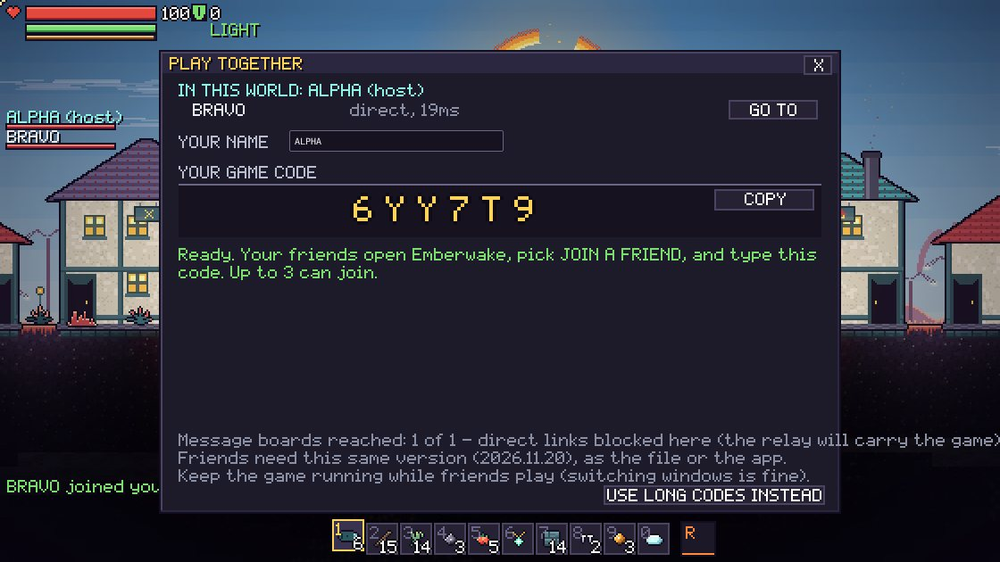
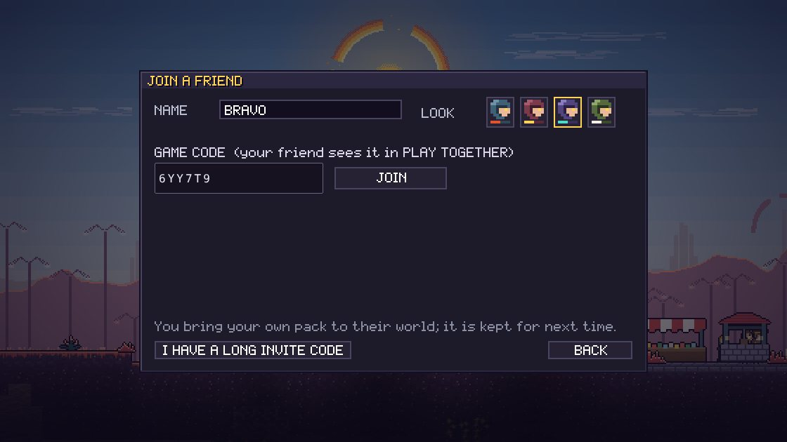
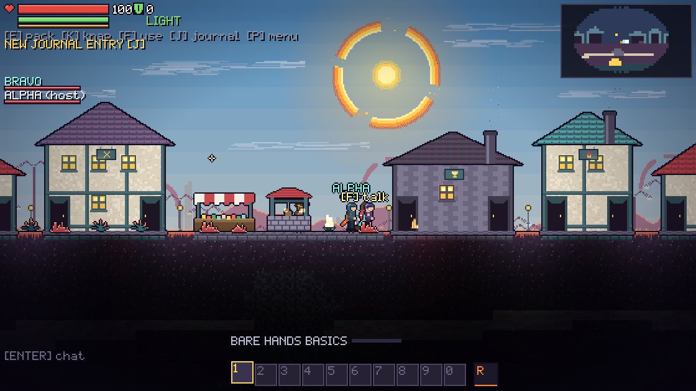

# Playing together

Up to four people can play in one world. One of you hosts: it is their world, and they save it. It works on any internet connection: home Wi-Fi, a phone hotspot, a school or office network.

## Hosting

Open your world, press **Esc** and choose **PLAY TOGETHER**. Your game shows a **game code**, six letters and numbers like `K7P2QX`. Tell it to your friends: say it, text it, anything.

You can host from **Emberwake.html** in a web browser (on Windows, a Mac or anything else) or from the Mac app, and friends can join from either. Keep the game open while friends play: switching to another window or tab is fine, but closing it ends the game for everyone. PLAY TOGETHER also shows how many message boards your network reached and whether a direct line is possible.

A world keeps its code from one time to the next, so friends can come back with the code they already have. **NEW CODE** makes a fresh one (only while nobody is in the world, since it would cut off anyone using the old one).

## Joining

On the title screen choose **JOIN A FRIEND**, type your name and the game code, and press **JOIN**. A few seconds later you are standing next to your friend. Up to three friends can join with the same code.

The first time a friend visits your world they start with **nothing**, just like you did: an empty pack, no armour, no trinkets. What they gather, make and wear is kept on their computer for the next time they visit that world. The join screen remembers the last code you typed.

## In the world together

- **What you share:** the land (everything anyone digs or builds), chests and stations, the creatures (the host's game runs them, so you all fight the same ones), the sky, events and bosses, explosions, and a chat (**Enter**).
- **Loot is everyone's own:** when a creature falls, each of you nearby gets your own share. Drop something from your pack and your friends can pick it up.
- **One at a time:** a chest, campfire, kiln or drying rack is used by one person at a time, so nothing gets doubled or lost. If someone else has it open, you're told who.
- **Finding each other:** friends show on your map and minimap, and a small arrow at the edge of the screen points to a friend out of sight, with how far away they are. In **PLAY TOGETHER**, each friend has a **GO TO** button that takes you to them.
- **Rifts follow the host:** when the host steps through, everyone goes. The guardians, the gate and the altars are the host's to wake (give the host your offering if you made it), but anyone can use a summon. Traps, the ballista and the warning bell are worked by the host's game, so they protect everyone.
- **Switching away:** with friends in your world, the game keeps running when you switch to another window or minimise it, so nobody is left frozen. While you're away your Waker rests: nothing can hurt it and it doesn't get hungry, and your friends see **away** over your head.

## How the games connect

You don't need to do anything here; this is just what happens behind the scenes.

- The games find each other with the code through public message boards on the internet: several at once, three of them on the web's own port (443), which almost every network allows. On claude.ai they use the page itself instead.
- Then they connect **directly**, which is the fastest. Most networks allow it.
- When a network won't allow that (strict school and office networks, some phone networks and routers), the games talk **through the relay**: the same message boards carry the game, bundled ten times a second, squeezed small, numbered, and sent again if anything goes missing. It's a little slower, but it gets through almost anywhere a web page can.
- If a direct line breaks in the middle of a game, the relay takes over by itself. If a direct line becomes possible later, the game switches back to it.
- If a friend's internet drops out for a while, their game keeps trying to get back in with the same code.
- Everything the games send each other is sealed with the code, so nobody without it can read it. The boards are free public services, so don't put secrets in the chat.

In **PLAY TOGETHER** you can see how each friend is connected (**direct** or **relay**) and how quick the line is, in milliseconds.

## If it doesn't connect

- Check the code: six letters and numbers, no spaces.
- Make sure the host has opened **PLAY TOGETHER** in this world since starting it.
- Make sure you both have the same version of the game. The title screen shows the version (for example *version 2026.11.20*), and if two versions meet, the game says so and tells you both versions.
- "Can't reach the internet" means none of the message boards could be reached from that network.
- **Backup:** **USE LONG CODES INSTEAD** (host) and **I HAVE A LONG INVITE CODE** (friend) bring back the old way: the host copies a long invite to the friend, and the friend copies a long reply back. Long codes need a direct line; they don't use the relay.

> The claude.ai page and the file are separate: people playing the page on claude.ai play with each other, and people using Emberwake.html or the app play with each other. (The claude.ai page isn't allowed to reach the message boards, so it uses its own room.)
