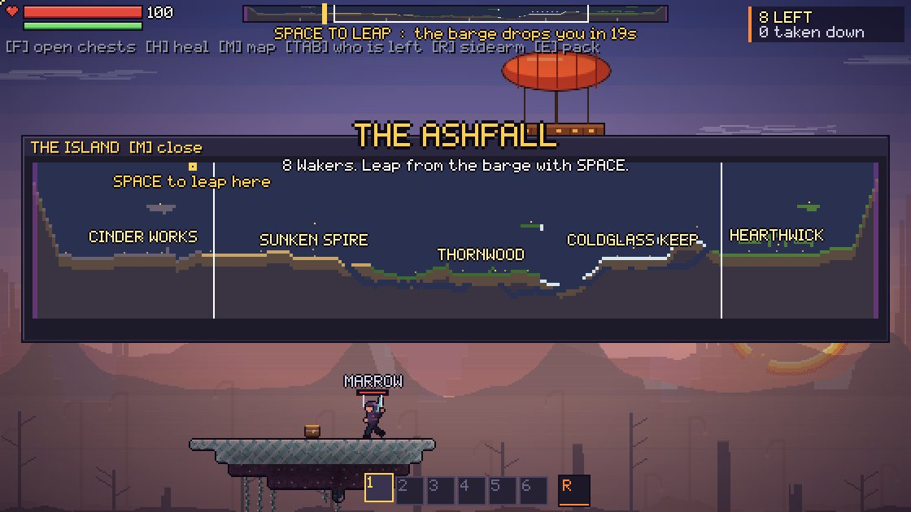

# The Ashfall: battle royale

On the title screen choose **THE ASHFALL : BATTLE ROYALE**.

## A match

Everyone rides the **Ember Barge** over a much larger, multi-biome island. Press **Space** to leap off wherever you like (the map shows where you are), then steer your glider down with **A / D** (hold **S** to dive). You land with basic craft materials and empty hands.

**Materials come first.** Trees can be cut for wood, and exposed stone and gravel can be mined for rock and flint. Open your pack (**E**) and use the hand-crafting list to make twine, arrows and basic flint or stone weapons. Chests are intentionally scarce, and most contain supplies rather than a complete weapon.

**Chests** (press **F**) usually hold medicine, wards, materials or a sidearm. Rare chests are more likely to contain better gear, with a glow showing rarity. **Ember Caches, Ashen Shrines and Ash Groves** are rare landmarks that give a one-time reward or temporary boost. Hold a salve or a ward and click to use it (or press **H**): it takes a moment, and a blow interrupts it.

The **ashfall** closes in from both sides. The strip at the top shows the safe ground, the next safe ground (white lines), and when it moves. Outside it you lose health, faster each time it closes. When you fall, you drop everything you carried and can watch the others (**A / D** to switch). The last one standing wins.

**Echoes** (computer players) fill the empty places so a match is never empty. **Tab** shows who is left, **M** the island.

## Three ways to play

- **PLAY WITH ECHOES:** you and seven echoes, right away.
- **HOST A MATCH FOR FRIENDS:** a lobby with a game code. Friends pick **JOIN A FRIEND** and type it, then you press **START NOW**. Works from the HTML file and the Mac app, on any internet connection (the relay carries it when needed, as in *Playing together*).
- **PLAY ONLINE** (only when the page is opened on claude.ai): everyone who has the page open and picks the same match name meets in one lobby. The first one in leads: the match starts after a short countdown, or when they press **START NOW**.
