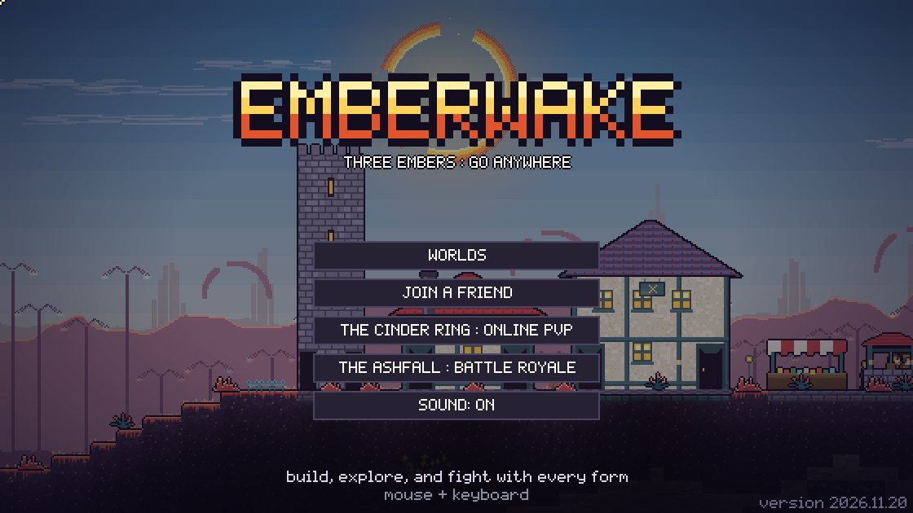

# Emberwake

**Emberwake** is a 2D pixel-art open-world action game inspired by *Terraria*. Gather resources, build a settlement, learn weapon styles, explore four linked worlds, and face powerful guardians—alone or with up to three friends.

Made with freemessycello and fish.co — a self-contained HTML game with no external runtime dependencies.



## Play

Ready-to-play builds are in [`Emberwake-1/`](Emberwake-1/).

Play the game in your browser at <https://rogersg61.github.io/Emberwake/>.

### macOS

Open [`Emberwake.app`](Emberwake-1/Emberwake.app). To keep it permanently, drag it into the Applications folder.

macOS may block the app because it is not notarized by Apple:

- **macOS 15 Sequoia and later:** open the app once, choose **Done**, then open **System Settings > Privacy & Security** and choose **Open Anyway**.
- **Earlier macOS:** right-click or Control-click the app, choose **Open**, then choose **Open** again.

### Windows, Linux, ChromeOS, or any modern browser

Open [`Emberwake.html`](Emberwake-1/Emberwake.html) directly in Chrome, Edge, Firefox, or Safari. It works without a server or internet connection for single-player play.

You can also open the included [`Emberwake Guide.html`](Emberwake-1/Emberwake%20Guide.html) for the complete in-game manual.

## Features

- Procedurally generated, endless exploration in the Waking Lands
- Three linked subterranean and astral worlds
- Mining, digging, building, furniture, storage, farming, fishing, and crafting
- Four weapon families, learned fighting styles, combos, counters, arts, armour, and trinkets
- Story leads, lore, echo stones, a journal, creatures, bosses, and world events
- Shared multiplayer worlds for up to four players
- The Ashfall, a battle royale mode with echoes or friends
- Synthesized pixel graphics and sound with no image or audio downloads

## Controls

| Input | Action |
| --- | --- |
| `A` / `D` | Move |
| `Space` or `W` | Jump |
| `S` | Hold to drop through bridges or aim down |
| `Shift` | Dodge |
| `Left mouse` | Light attack |
| `Right mouse` or `Q` | Heavy attack or charge |
| `E` | Pack, equipment, and hand crafting |
| `B` | Recipe book |
| `C` | Combat forms |
| `F` | Talk or use |
| `G` | Drop held item |
| `H` | Quick heal |
| `J` | Journal |
| `M` | Map |
| `P` or `Esc` | Pause menu |
| `Enter` | Chat while playing together |
| `1`–`0` / mouse wheel | Select hotbar item |

See [`Emberwake Guide.html`](Emberwake-1/Emberwake%20Guide.html) or [`Source/guide/`](Emberwake-1/Source/guide/) for the full controls and gameplay guide.

## Playing together

1. Open a world and press `Esc`.
2. Choose **PLAY TOGETHER**.
3. Share the generated six-character game code with a friend.
4. Your friend chooses **JOIN A FRIEND**, enters their name and the code, and joins.

Emberwake uses direct peer-to-peer connections when possible and falls back to a relay when restrictive networks block them. Multiplayer does not require port forwarding.

To move a save between the Mac app and a browser or another computer, open the world list and use **COPY**, then use **PASTE A WORLD** on the destination.

> Every player must use the same Emberwake version. On different computers, share the latest `Emberwake.html` or `Emberwake.app` build.

## Building from source

The source has no package or dependency installation step. It requires Python 3; Node.js is optional and enables JavaScript syntax checking during the build.

```bash
cd Emberwake-1/Source

# Build the game, guide, and macOS app
python3 build.py

# Build only Emberwake.html
python3 build.py --game

# Build the HTML game and guide without rebuilding the app
python3 build.py --no-app
```

The build output is written to `Emberwake-1/`:

- `Emberwake.html` — cross-platform browser game
- `Emberwake Guide.html` — generated HTML guide
- `Emberwake.app` — macOS application bundle

The builder concatenates numbered JavaScript source files, checks for duplicate top-level names, validates syntax with Node.js when available, embeds guide images, and packages the Mac app.

## Source layout

| Path | Purpose |
| --- | --- |
| [`Emberwake-1/Source/game/`](Emberwake-1/Source/game/) | Numbered JavaScript game modules |
| [`Emberwake-1/Source/guide/`](Emberwake-1/Source/guide/) | Guide chapters and embedded images |
| [`Emberwake-1/Source/mac/`](Emberwake-1/Source/mac/) | macOS launcher, window shell, and app metadata |
| [`Emberwake-1/Source/tests/`](Emberwake-1/Source/tests/) | Automated Playwright browser tests |
| [`Emberwake-1/Source/build.py`](Emberwake-1/Source/build.py) | Game, guide, and app builder |

The JavaScript modules share one global scope. Files load in numeric folder and filename order, and the builder prevents accidental duplicate names.

## Testing

The browser tests require Python, Playwright, and Chromium:

```bash
cd Emberwake-1/Source
pip install playwright pillow
python3 -m playwright install chromium

python3 tests/run.py
python3 tests/run.py together
python3 tests/run.py together/relay.py
```

See [`Emberwake-1/Source/tests/README.md`](Emberwake-1/Source/tests/README.md) for test groups and setup details.

## Saving

Saves are stored locally on the computer and browser profile used to play. The app and browser are separate storage environments. World lists include copy/paste controls for transferring saves.
